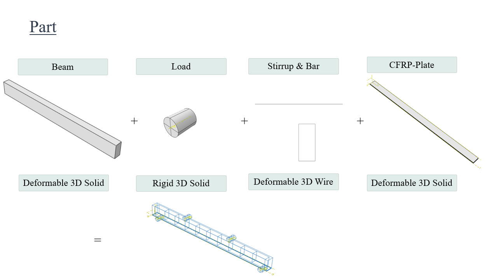
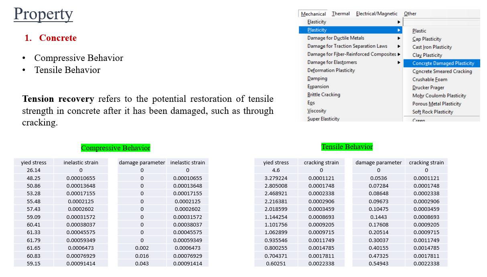
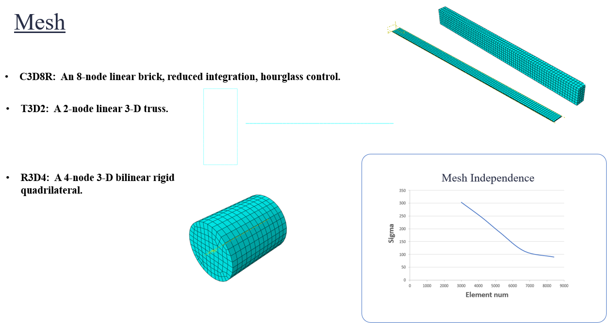
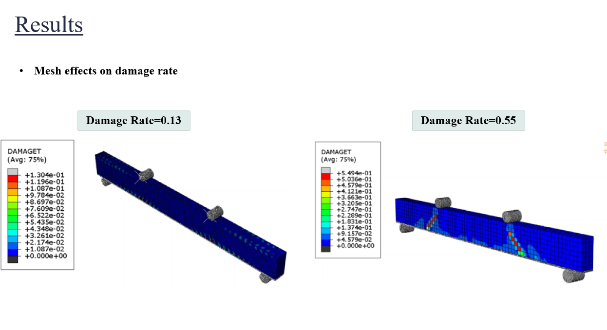

# RC_Beam_CFRP_Strengthening_Abaqus
Finite element analysis of a reinforced concrete beam under four-point bending, comparing responses with and without CFRP strengthening using Abaqus.
## Project Overview

This project investigates the response of a reinforced concrete beam under four-point bending using Abaqus. Two configurations are analyzed under the same loading and support conditions: (1) an unstrengthened reinforced concrete beam, and (2) the same beam strengthened with a four-layer CFRP plate on its bottom face. The nonlinear behavior of the concrete is modeled with the Concrete Damaged Plasticity (CDP) model.

## Objectives

- Model a reinforced concrete beam under four-point bending using the CDP model.
- Represent the steel stirrups and bars with embedded truss elements.
- Model a four-layer orthotropic CFRP plate with fiber orientations of 0°, 90°, +45°, and −45°.
- Compare the numerical response of the beam with and without CFRP strengthening.
- Check the mesh quality with a mesh independence study.

## Model Configuration

| Item | Description |
|---|---|
| Beam dimensions | 2100 × 200 × 100 mm |
| Analysis | 3D finite element analysis, Static General with stabilization (energy dissipation fraction) |
| Loading | Four-point bending (two loading points and two supports) |
| Reinforcement | Steel stirrups and bars |
| Strengthening | Four-layer CFRP plate (second configuration) |

### Parts

| Part | Type |
|---|---|
| Beam | Deformable 3D solid |
| Load | Rigid 3D solid (cylinder, 40 mm radius, 100 mm depth) |
| Stirrup & Bar | Deformable 3D wire |
| CFRP plate | Deformable 3D solid |

The steel reinforcement is placed inside the beam, and the CFRP plate is placed on the bottom face of the beam in the strengthened configuration. Circular partitions at the load and support locations, together with partitions in the longitudinal and transverse directions, were created to control the mesh in these regions.

## Material Modeling

### Concrete (Concrete Damaged Plasticity)

| Parameter | Value |
|---|---|
| Dilation angle | 40° |
| Eccentricity | 0.1 |
| Viscosity parameter | 0.001 |
| Tension stiffness recovery | 0.7 |

The compressive behavior (yield stress and damage parameter versus inelastic strain) and the tensile behavior (yield stress and damage parameter versus cracking strain) were defined from tabulated data. In the tabulated compressive data, the stress rises to about 62 MPa and then softens. In the tabulated tensile data, the stress starts at 4.6 MPa and decreases as the cracking strain grows, with the tensile damage parameter reaching about 0.55.

The tension stiffness recovery factor controls how much of the elastic tensile stiffness is recovered when the loading changes from compression to tension after damage.

### Steel Reinforcement

The steel stirrups and bars are defined as linear elastic using Young's modulus.

### CFRP

The CFRP plate is defined as an orthotropic elastic material using engineering constants. It consists of four layers, with fiber orientations of 0°, 90°, +45°, and −45°. A separate local coordinate system was defined for each layer to assign its fiber direction.

## Interactions, Boundary Conditions, and Loading

- Embedded region: the steel stirrups and bars are embedded in the concrete.
- Contact: contact is defined between the rigid cylinders and the beam, with penalty friction.
- Supports: the two bottom supports are pinned.
- Loading: a vertical displacement is applied through the two top loading points, with all other degrees of freedom fixed.
- Analysis step: Static General with an energy dissipation fraction to help convergence once damage develops.

## Meshing

| Element | Description | Used for |
|---|---|---|
| C3D8R | 8-node linear brick, reduced integration, hourglass control | Concrete beam and CFRP plate |
| T3D2 | 2-node linear 3D truss | Stirrups and bars |
| R3D4 | 4-node 3D bilinear rigid quadrilateral | Loading cylinders |
The approximate global size of the beam mesh is 8 mm. The same mesh was used for both configurations; only the results change.

### Mesh Independence Study

The maximum stress was monitored as the number of elements increased from about 3,000 to about 8,400. The stress decreases with refinement, and the curve flattens toward the finest meshes. Because maximum stress can be sensitive near contact regions, a global response measure such as the reaction force at a given displacement would give a stronger check.

### Effect of Mesh on Damage

The tensile damage variable (DAMAGET) was compared for two different meshes. The maximum tensile damage is 0.13 for the first mesh and 0.55 for the second. In the second mesh, the damage localizes in inclined bands near the loading points, while in the first mesh it remains small and distributed. This shows that the predicted damage level depends on the mesh, which is typical for softening concrete models where damage localizes in a narrow band of elements. For this reason, the comparison between the two beam configurations was carried out with the same mesh.

## Limitations

- The study is numerical; no experimental comparison is included.
- The predicted damage depends on the mesh (see Effect of Mesh on Damage), so damage values should be compared only between models with the same mesh.
- The complete Abaqus project files are not included in this repository.

## Software

Abaqus
